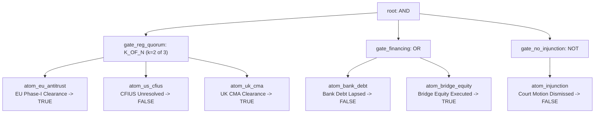

# Clause Circuit (`ClauseCircuit`)

**Kleene 3-Valued Boolean Predicate Graph (`AND` / `OR` / `NOT` / `K_OF_N`) Closing-Condition Escrow on GenLayer StudioNet**

`ClauseCircuit` implements a directed acyclic boolean predicate circuit over independently adjudicated semantic atoms, backed by real native value escrow (`@gl.public.write.payable` + `_EoaRecipient.emit_transfer`) on **GenLayer StudioNet (Chain ID `61999`)**.

---

## 1. Why Only GenLayer Can Do This

Real-world closing conditions (such as Cross-Border M&A escrows) are rarely flat checklists where every single item must pass. Instead, they compose **regulatory quorums (`K_OF_N`)**, **alternative financing fallbacks (`OR`)**, and **fail-closed negative covenants (`NOT`)**:

- **Traditional Smart Contracts** cannot read commit-pinned regulatory filings, lender commitment letters, or court dockets to judge whether a natural-language closing condition holds or is contradicted.
- **Flat LLM Checklists** cannot deterministically enforce acyclicity (Kahn's topological sort), `K_OF_N` quorum short-circuiting, `OR` fallback recovery, or fail-closed Kleene 3-valued negation (`NOT(UNKNOWN) = UNKNOWN` — ensuring an unevaluated or unverifiable negative condition never silently passes).

In `ClauseCircuit`, **validators judge only bounded leaf atoms (`TRUE` / `FALSE` / `UNKNOWN`)**, while **pure deterministic Python** validates DAG acyclicity, evaluates the Kleene 3-valued ($K_3$) circuit bottom-up, and executes real native value settlement.

---

## 2. Live StudioNet Demo Topology (Cross-Border M&A Closing Circuit)



- **Non-Trivial Resolution**: Two leaf atoms (`atom_us_cfius` and `atom_bank_debt`) evaluate to `FALSE` (a flat checklist would fail), yet `K_OF_N(2/3)` resolves `TRUE`, `OR(FALSE, TRUE)` resolves `TRUE`, and `NOT(FALSE)` resolves `TRUE` (after `X6` proves `NOT(UNKNOWN) = UNKNOWN` blocks premature settlement), releasing `1000` wei native escrow to `beneficiary`.

---

## 3. Built-In Consensus & Security Invariants

1. **Real Native Value Escrow (Zero Trapped Wei)**: `open_circuit` is `@gl.public.write.payable` requiring `int(gl.message.value) == escrow_amount` and reverting via `gl.vm.UserError` on every invalid input. `withdraw_payout` follows strict Checks-Effects-Interactions and dispatches real native wei via `_EoaRecipient(gl.message.sender_address).emit_transfer(value=u256(amount))`. `cancel_draft_circuit` and permissionless post-deadline `expire_circuit` guarantee 100% refundability.
2. **Retriable `UNKNOWN` + Conclusive Immutability**: Transient fetch/parse/hash failures (`UNKNOWN`) remain retriable up to `MAX_ATOM_ATTEMPTS = 5` (tracking `attempts`), while conclusive `TRUE`/`FALSE` verdicts are immutable (`ATOM_ALREADY_CONCLUDED`).
3. **Strict `ATOM_VERDICT_REASONS` Compatibility Matrix**: `TRUE -> {CLAIM_VERIFIED}`, `FALSE -> {CLAIM_CONTRADICTED}`, `UNKNOWN -> {FETCH_OR_PARSE_FAILURE, HASH_MISMATCH}` enforced in `leader_fn`, `validator_fn` (exact 5-field canonical JSON + `type(a) is type(b)`), and pre-storage assertion.
4. **Fail-Closed Clock & Bounds**: Uses only `gl.message_raw["datetime"]` (`NO_BLOCK_TIME` if unavailable, zero `time_offset` backdoors), `MAX_NODES = 24`, `MAX_ATOMS = 12`, `MAX_EVIDENCE_BYTES = 2500`, and reusable commit-pinned `raw.githubusercontent.com/<owner>/<repo>/<40-hex-sha>/<path>` allowlisting.

---

## 4. Verified StudioNet Deployment & 30-Transaction Ledger

| Artifact | Value / Explorer Link |
|---|---|
| **Repository** | [https://github.com/Kanezar3/Clause-Circuit](https://github.com/Kanezar3/Clause-Circuit) |
| **Deploy Commit SHA** | `7d72a5eef2ada8afa4f6c4a23ff2f236108a70a5` |
| **Contract Source (Pinned)** | [`contracts/clause_circuit.py`](https://github.com/Kanezar3/Clause-Circuit/blob/7d72a5eef2ada8afa4f6c4a23ff2f236108a70a5/contracts/clause_circuit.py) |
| **Git Blob SHA-1 / On-Chain SHA-256** | `2427bea408e22f70a16fd5003126c7f7d25f407c` / `4a338dbbf69f98356e71e590643c8456118f18b96dc0432c0096510ec2ab3c42` (`blobEqualityVerified: true`) |
| **Runner Probe Contract** | [`0x079d803C3154B8BEA59818E09d1E9CE1270Daf4f`](https://explorer-studio.genlayer.com/address/0x079d803C3154B8BEA59818E09d1E9CE1270Daf4f) |
| **Main Contract (`ClauseCircuit`)** | [`0xCC0903589e9e3baEA151BAde30D87A592Bc00137`](https://explorer-studio.genlayer.com/address/0xCC0903589e9e3baEA151BAde30D87A592Bc00137) |
| **Main Deploy Tx** | [`0xa2458956...dcb7f16`](https://explorer-studio.genlayer.com/tx/0xa2458956e5db1f2838996fffc86f51fe783fae1a163d39f27d1163753dcb7f16) |
| **Release Manifest** | [`release_manifest.json`](release_manifest.json) |

### Key Positive Steps & Deliberate Abuse Guards (All `FINALIZED`)

| Step | Method | Caller | Result / Expected Guard | Explorer Tx |
|---|---|---|---|---|
| **X1** | `open_circuit` | Attacker | `ERROR` (`UNAUTHORIZED_CALLER`) | [`0x9139ffd3...`](https://explorer-studio.genlayer.com/tx/0x9139ffd30cf6661d4c2d9ea0d3dba134498b20db84d1540ac75766752f0caa94) |
| **X2** | `open_circuit` | Sponsor | `ERROR` (`ESCROW_VALUE_MISMATCH`) | [`0x7c9bbe9b...`](https://explorer-studio.genlayer.com/tx/0x7c9bbe9b8e4d35352416781183a88a1e3345d77a6493a1aab642726125739ec2) |
| **S1** | `open_circuit` | Sponsor | `CIRCUIT_OPENED:ESCROW_1000` (`1000` wei payable) | [`0x350fd5c4...`](https://explorer-studio.genlayer.com/tx/0x350fd5c46b5668e53a36ea36117cdf6ccf8f2c10433e5758404c9984f9fb81b5) |
| **X3** | `add_atom` | Sponsor | `ERROR` (`INVALID_EVIDENCE_URL` — unpinned `/main/`) | [`0xc592f043...`](https://explorer-studio.genlayer.com/tx/0xc592f0431292af925d33e5595e066d8cdae97a09d695b7c882fd783882b9e9dc) |
| **X4** | `freeze_circuit` | Sponsor | `ERROR` (`CYCLE_DETECTED` — Kahn cycle guard) | [`0xcd5181bb...`](https://explorer-studio.genlayer.com/tx/0xcd5181bbc8957606b7baf7e910a7b0a5cf28ad66749d219821449bdc2d6928dd) |
| **S12** | `freeze_circuit` | Sponsor | `CIRCUIT_FROZEN:root:NODES_10` | [`0xbb733d28...`](https://explorer-studio.genlayer.com/tx/0xbb733d2851bc069dbd4baae1a22f5615f713d4944f3f4098e62be49d18601a6e) |
| **S13** | `evaluate_atom` | Solver | `ATOM_CONCLUDED:atom_eu_antitrust:TRUE:CLAIM_VERIFIED` | [`0x0e89ca16...`](https://explorer-studio.genlayer.com/tx/0x0e89ca16303343a5e5ee3d3ebd58eff41398b68c4359eb2f49483359f042f076) |
| **X5** | `evaluate_atom` | Attacker | `ERROR` (`ATOM_ALREADY_CONCLUDED` — immutability) | [`0x2bb10c49...`](https://explorer-studio.genlayer.com/tx/0x2bb10c498384633d42c8aaab1a68215218124f4ab912ad3a6b06b89e9b509685) |
| **S14** | `evaluate_atom` | Solver | `ATOM_CONCLUDED:atom_us_cfius:FALSE:CLAIM_CONTRADICTED` | [`0x9d217ed5...`](https://explorer-studio.genlayer.com/tx/0x9d217ed50136191db4b75b2820f01df1f13854f12589a98b68ff4c7f30c42f4e) |
| **S15** | `evaluate_atom` | Solver | `ATOM_CONCLUDED:atom_uk_cma:TRUE:CLAIM_VERIFIED` (`K_OF_N` 2/3 = `TRUE`) | [`0x7381617c...`](https://explorer-studio.genlayer.com/tx/0x7381617c86a445ef63d671fd1be5899c0ef62614cd8668e42ece6e0253f1f716) |
| **S16** | `evaluate_atom` | Solver | `ATOM_CONCLUDED:atom_bank_debt:FALSE:CLAIM_CONTRADICTED` | [`0xb6ce5a78...`](https://explorer-studio.genlayer.com/tx/0xb6ce5a78eb649625589ad2910a4f52c13e0d59656b51ce241cd6d85b0ce240db) |
| **S17** | `evaluate_atom` | Solver | `ATOM_CONCLUDED:atom_bridge_equity:TRUE:CLAIM_VERIFIED` (`OR` = `TRUE`) | [`0x443ec3c7...`](https://explorer-studio.genlayer.com/tx/0x443ec3c73a6d482f1d9834089e0bdbefab4f4ed2ef326dd3c3f83cf2edb92a47) |
| **X6** | `settle_circuit` | Solver | `ERROR` (`CIRCUIT_STILL_UNDETERMINED` — `NOT(UNKNOWN)=UNKNOWN`) | [`0xe81f3ad1...`](https://explorer-studio.genlayer.com/tx/0xe81f3ad17f741d3466bc8978da1956a1bf069ba0d7c4d61188b40cc6d9d42c32) |
| **S18** | `evaluate_atom` | Solver | `ATOM_CONCLUDED:atom_injunction:FALSE:CLAIM_CONTRADICTED` (`NOT(FALSE)=TRUE`) | [`0x30ef2799...`](https://explorer-studio.genlayer.com/tx/0x30ef27996f8d176f7730dc0f8cc46d02b64f1146977705b708f23b08510c9e7a) |
| **S19** | `settle_circuit` | Solver | `SETTLED:RELEASED_TO_BENEFICIARY:AMOUNT_1000` | [`0x58848995...`](https://explorer-studio.genlayer.com/tx/0x58848995972d6240eec0f556f7a4ce84e0ff97bc53dd158dc9d017430dc1d42c) |
| **X7** | `settle_circuit` | Attacker | `ERROR` (`CIRCUIT_ALREADY_SETTLED` — replay blocked) | [`0xcfd97685...`](https://explorer-studio.genlayer.com/tx/0xcfd97685b07cb75a6ecb759cab5421a4f837b2257bdc77a338d6f67a189a850e) |
| **X8** | `withdraw_payout` | Attacker | `ERROR` (`NO_PENDING_PAYOUT`) | [`0x701f7982...`](https://explorer-studio.genlayer.com/tx/0x701f798274669d2b827437588a14f6c1a8bf3e8698360d4aa3d8ed7f9a900138) |
| **S20** | `withdraw_payout` | Beneficiary | `1000` (EOA balance `0 -> 1000` wei, `conservation_ok: true`) | [`0x55571966...`](https://explorer-studio.genlayer.com/tx/0x55571966de626433bbbac0bb405cfe7be59e64fe20fb60d6f8a3c8fe9194f038) |

*(Full 30-transaction ledger including `S2–S11C` setup calls, validator votes, and state read-backs is recorded in [`release_manifest.json`](release_manifest.json).)*

---

## 5. Local Verification

```bash
genvm-lint contracts/clause_circuit.py
pytest tests -v
```
- `genvm-lint`: **3/3 checks passed**
- `pytest`: **8/8 tests passed** covering Kleene $K_3$ happy path, short-circuit falsification, adversarial leader tampering, compatibility tables, retriable `UNKNOWN` + conclusive immutability, Kahn cycle detection, fail-closed evidence, and global bounds.
