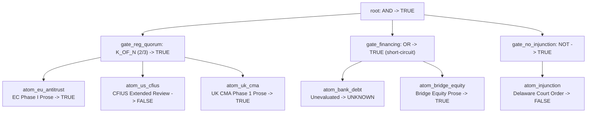

# Clause Circuit (`ClauseCircuit`)

**Bilateral Kleene 3-Valued Boolean Predicate Graph (`AND` / `OR` / `NOT` / `K_OF_N`) Closing-Condition Escrow with Real Native Transfers on GenLayer StudioNet**

`ClauseCircuit` implements a bilaterally agreed directed acyclic boolean predicate circuit over independently adjudicated natural-language filings, backed by real native value escrow (`@gl.public.write.payable` + `_EoaRecipient.emit_transfer`) on **GenLayer StudioNet (Chain ID `61999`)**.

---

## 1. Why Only GenLayer Can Do This

Real-world closing conditions (such as Cross-Border M&A escrows) are rarely flat checklists where every item must pass. Instead, they compose **regulatory quorums (`K_OF_N`)**, **alternative financing fallbacks (`OR`)**, and **fail-closed negative covenants (`NOT`)**:

- **Why validators still matter under bilateral consent**: Sponsor and beneficiary mutually freeze the closing-condition graph, claims, and evidence digests up front (`DRAFT -> PROPOSED -> FROZEN`), while GenLayer validators independently adjudicate external regulatory, lender, and judicial prose that neither party can unilaterally dictate or verify deterministically.
- **Why flat LLM checklists fall short**: Ordinary deterministic Python enforces DAG acyclicity and zero orphan draft nodes (Kahn's topological sort), `K_OF_N` quorum tolerance, live Kleene $K_3$ `OR(UNKNOWN, TRUE) == TRUE` short-circuiting, fail-closed `NOT(UNKNOWN) == UNKNOWN` negation, and real native value settlement.

In `ClauseCircuit`, **validators judge only bounded leaf atoms (`TRUE` / `FALSE` / `UNKNOWN`) from natural-language prose**, while **pure deterministic Python** validates topology, evaluates the Kleene $K_3$ circuit bottom-up, and settles real native funds.

---

## 2. Live StudioNet Demo Topology (Cross-Border M&A Closing Circuit)



- **Non-Trivial Live Resolution**:
  1. `gate_reg_quorum` (`K_OF_N` 2/3) resolves `TRUE` despite `atom_us_cfius = FALSE` (a flat `AND` checklist would fail).
  2. `gate_financing` (`OR`) **short-circuits to `TRUE` live on-chain** once `atom_bridge_equity = TRUE` while `atom_bank_debt` remains unevaluated (`UNKNOWN`).
  3. `gate_no_injunction` (`NOT`) enforces **fail-closed `NOT(UNKNOWN) == UNKNOWN`** (`X7` reverts `CIRCUIT_STILL_UNDETERMINED`), then flips to `NOT(FALSE) == TRUE` after Delaware court prose proves the injunction motion was dismissed with prejudice, releasing `0.5 GEN` (`500000000000000000` wei) native escrow to `beneficiary`.

---

## 3. Built-In Consensus & Security Invariants

1. **Bilateral Consent & Zero Orphan Nodes**: Sponsor opens payable escrow (`DRAFT`), drafts atoms/gates (with `remove_draft_node` cleanup), and locks topology via `propose_circuit` (`DRAFT -> PROPOSED`, rejecting `CYCLE_DETECTED`, `DANGLING_CHILD_REF`, and `UNREACHABLE_DRAFT_NODES`). Beneficiary must inspect and call `accept_circuit` (`PROPOSED -> FROZEN`) or `reject_circuit` (`REJECTED_REFUNDED`).
2. **Real Native Value Escrow (Zero Trapped Wei)**: `open_circuit` is `@gl.public.write.payable` requiring exact `int(gl.message.value) == escrow_amount`. `withdraw_payout` follows strict Checks-Effects-Interactions and dispatches real native wei via `_EoaRecipient(gl.message.sender_address).emit_transfer(value=u256(amount))`. `cancel_draft_circuit`, `reject_circuit`, and permissionless post-deadline `expire_circuit` guarantee 100% refundability.
3. **Strict Fail-Closed Compatibility & Exact 5-Field Consensus**: `ATOM_VERDICT_REASONS` maps `TRUE -> {CLAIM_VERIFIED}`, `FALSE -> {CLAIM_CONTRADICTED}`, `UNKNOWN -> {FETCH_OR_PARSE_FAILURE, HASH_MISMATCH, INCONCLUSIVE_EVIDENCE}`. Any self-contradictory pair (including `TRUE` + `CLAIM_CONTRADICTED`, which would flip under `NOT`) fails closed to retriable `UNKNOWN`. `validator_fn` enforces exact 5-field canonical JSON and Python type equality (`type(a) is type(b)`), with zero `self` references in nondeterministic closures.
4. **Retriable `UNKNOWN` + Conclusive Immutability**: `UNKNOWN` remains retriable up to `MAX_ATOM_ATTEMPTS = 5`, while `TRUE`/`FALSE` are immutable (`ATOM_ALREADY_CONCLUDED`).
5. **Fail-Closed Clock & Bounds**: Uses only trusted `gl.message_raw["datetime"]` (`NO_BLOCK_TIME` if absent, zero `time_offset` backdoors), `MAX_NODES = 24`, `MAX_ATOMS = 12`, `MAX_EVIDENCE_BYTES = 2500`, and commit-pinned `raw.githubusercontent.com/<owner>/<repo>/<40-hex-sha>/<path>` allowlisting.

---

## 4. Verified StudioNet Deployment & 34-Transaction Ledger

| Artifact | Value / Explorer Link |
|---|---|
| **Repository** | [https://github.com/Kanezar3/Clause-Circuit](https://github.com/Kanezar3/Clause-Circuit) |
| **Deploy Commit SHA** | `d56f7eca43e073b7f0c84ab015052cf1bb034802` |
| **Contract Source (Pinned)** | [`contracts/clause_circuit.py`](https://github.com/Kanezar3/Clause-Circuit/blob/d56f7eca43e073b7f0c84ab015052cf1bb034802/contracts/clause_circuit.py) |
| **Git Blob SHA-1 / On-Chain SHA-256** | `a5ee58170d2ded12b8e00a5c056e14d221a47a1d` / `41ed3d55c23df196d7b802b58f1aa81bb998c25e492c16956393552d7be8a83c` (`blobEqualityVerified: true`) |
| **Runner** | `py-genlayer:1jb45aa8ynh2a9c9xn3b7qqh8sm5q93hwfp7jqmwsfhh8jpz09h6` |
| **Runner Probe Contract** | [`0x66EEB6F0C8B4077a93C3b3892fb9a80b09ee7B13`](https://explorer-studio.genlayer.com/address/0x66EEB6F0C8B4077a93C3b3892fb9a80b09ee7B13) (`probe_ok`) |
| **Main Contract (`ClauseCircuit`)** | [`0xBc668baE5C965080F28fDA1bAe2D1F67317E4eec`](https://explorer-studio.genlayer.com/address/0xBc668baE5C965080F28fDA1bAe2D1F67317E4eec) |
| **Main Deploy Tx** | [`0x1206ae01...300df7a`](https://explorer-studio.genlayer.com/tx/0x1206ae01d7dbf80eb2531c399e900a9edace1c31fa702212c859d9767300df7a) |
| **Release Manifest** | [`release_manifest.json`](release_manifest.json) (34 txs, 0 blank errors, 34/34 read-backs) |

### Key Positive Steps & Deliberate Abuse Guards (All `FINALIZED`)

| Step | Method | Caller | Execution / Exact Decoded Output | Explorer Tx |
|---|---|---|---|---|
| **X1** | `open_circuit` | Attacker | `ERROR` — `UNAUTHORIZED_CALLER` | [`0x89f8b52f...`](https://explorer-studio.genlayer.com/tx/0x89f8b52fa45a5e2c93b910c6efb0fdd425a2301214de2f5c7424b23a6f0f5156) |
| **X2** | `open_circuit` | Sponsor | `ERROR` — `ESCROW_VALUE_MISMATCH` | [`0x0384aee0...`](https://explorer-studio.genlayer.com/tx/0x0384aee0653730d06e14fcb8fc2c2d8c4a6a70364a6ecbaaf5e1be35b6e4d81e) |
| **S1** | `open_circuit` | Sponsor | `SUCCESS` — `CIRCUIT_OPENED:ESCROW_500000000000000000` (0.5 GEN) | [`0x28a8f946...`](https://explorer-studio.genlayer.com/tx/0x28a8f946724aa7f34dab69f36ba6723dc0fb8250ee42d78ff66093052e90f6d8) |
| **X3** | `add_atom` | Sponsor | `ERROR` — `INVALID_EVIDENCE_URL` (unpinned `/main/`) | [`0x37785d71...`](https://explorer-studio.genlayer.com/tx/0x37785d71dd7398331259908fc0f2ae488c6e7878645869e327a32bf34cf60c58) |
| **S8_RETRY** | `add_gate` | Sponsor | `ERROR` — `NODE_ALREADY_EXISTS` (RPC 502 retry; labeled in manifest) | [`0x72d24a57...`](https://explorer-studio.genlayer.com/tx/0x72d24a578aa7a2f8dd6f119898cb214d9899df0fd546e5982da9af833496d26e) |
| **X4** | `propose_circuit` | Sponsor | `ERROR` — `CYCLE_DETECTED` (Kahn's topological sort) | [`0x2a248952...`](https://explorer-studio.genlayer.com/tx/0x2a2489522eb6d29f5df4119b8362a88a1f2a6cad8fe38ab94261883827bd17d3) |
| **S12** | `propose_circuit` | Sponsor | `SUCCESS` — `CIRCUIT_PROPOSED:root:NODES_10` (`nodes_count: 10`) | [`0xe265fbd3...`](https://explorer-studio.genlayer.com/tx/0xe265fbd3409522fc9eff04971f6562d4f50631833fbc0a4b590cf2c6e516d3d0) |
| **X5** | `accept_circuit` | Sponsor | `ERROR` — `UNAUTHORIZED_CALLER` (bilateral consent guard) | [`0x7fc75a13...`](https://explorer-studio.genlayer.com/tx/0x7fc75a13aafc825c4390ab7d4b7739f29244400c7a375532713e603b956f4515) |
| **S13** | `accept_circuit` | Beneficiary | `SUCCESS` — `CIRCUIT_FROZEN:root:NODES_10` | [`0xbd61461e...`](https://explorer-studio.genlayer.com/tx/0xbd61461eca6263ce98e852ad34161e6865ee29c3038847a9367ecfdd7854451c) |
| **S14** | `evaluate_atom` | Solver | `SUCCESS` — `ATOM_CONCLUDED:atom_eu_antitrust:TRUE:CLAIM_VERIFIED` | [`0x66571660...`](https://explorer-studio.genlayer.com/tx/0x665716602f3fdd4e82cbc816689c8cd5e16e0b8cd7c6d89d4e055e1bba6ebdd1) |
| **X6** | `evaluate_atom` | Attacker | `ERROR` — `ATOM_ALREADY_CONCLUDED` (immutability) | [`0x3151b82f...`](https://explorer-studio.genlayer.com/tx/0x3151b82fb52db2b44b349ee934741505f6f95b6e4514c1c4ae7a97998dcde6aa) |
| **S15** | `evaluate_atom` | Solver | `SUCCESS` — `ATOM_CONCLUDED:atom_us_cfius:FALSE:CLAIM_CONTRADICTED` | [`0x006af32a...`](https://explorer-studio.genlayer.com/tx/0x006af32a8005b06a4da5ad784ebe827f4cfb18e0bc45989b4dec13bd25dfb981) |
| **S16** | `evaluate_atom` | Solver | `SUCCESS` — `ATOM_CONCLUDED:atom_uk_cma:TRUE:CLAIM_VERIFIED` (`K_OF_N` 2/3 = `TRUE`) | [`0x8c1c000b...`](https://explorer-studio.genlayer.com/tx/0x8c1c000b17fa544c5520263dcd003dd8c55ba46140ab13e9a69ce460e8153d5c) |
| **S17** | `evaluate_atom` | Solver | `SUCCESS` — `ATOM_CONCLUDED:atom_bridge_equity:TRUE:CLAIM_VERIFIED` (`OR(UNKNOWN, TRUE)=TRUE`) | [`0x97f4dff9...`](https://explorer-studio.genlayer.com/tx/0x97f4dff996b72bce1e55612d4fcb493a947fb7733f936a1bb1fabb86f2b237d1) |
| **X7** | `settle_circuit` | Solver | `ERROR` — `CIRCUIT_STILL_UNDETERMINED` (`NOT(UNKNOWN)=UNKNOWN`) | [`0x00712482...`](https://explorer-studio.genlayer.com/tx/0x00712482e639c18c7a1b227a6ecb850a7e5b51a64e5bd92f2bf80bde73ec4820) |
| **S18** | `evaluate_atom` | Solver | `SUCCESS` — `ATOM_CONCLUDED:atom_injunction:FALSE:CLAIM_CONTRADICTED` (`NOT(FALSE)=TRUE`) | [`0x0c0b5cb4...`](https://explorer-studio.genlayer.com/tx/0x0c0b5cb4f2b60a3ee1e174ac560be7bb5da1667776e505390d3e85dbb9bdd565) |
| **S19** | `settle_circuit` | Solver | `SUCCESS` — `SETTLED:RELEASED_TO_BENEFICIARY:AMOUNT_500000000000000000` | [`0x44a17de2...`](https://explorer-studio.genlayer.com/tx/0x44a17de2106cc89db5cf8771c9d17e296cf66052cf0f35d177cfa4528bcfdff2) |
| **X8** | `settle_circuit` | Attacker | `ERROR` — `CIRCUIT_ALREADY_SETTLED` (replay blocked) | [`0x216d6478...`](https://explorer-studio.genlayer.com/tx/0x216d647817b2f936090b4ec1337b3ea8ddded880d8231146132480b27bf0c140) |
| **X9** | `withdraw_payout` | Attacker | `ERROR` — `NO_PENDING_PAYOUT` | [`0xcfb31c9e...`](https://explorer-studio.genlayer.com/tx/0xcfb31c9e1acf16812ad3229b164227ff88a3e7814071727744ebd72c74a321b8) |
| **S20** | `withdraw_payout` | Beneficiary | `SUCCESS` — `500000000000000000` (contract `0.5 -> 0 GEN`; EOA `+0.49987 GEN` net of v2 fee) | [`0x5edc46bc...`](https://explorer-studio.genlayer.com/tx/0x5edc46bc3ff6846a36a87470c132fcf1b2ac7de893260bd3a5d4add918224380) |

*(All 34 finalized transactions—including setup `S2–S11E`, validator votes, exact decoded outputs, and 34/34 state read-backs—are recorded in [`release_manifest.json`](release_manifest.json).)*

---

## 5. Local Verification

```bash
genvm-lint contracts/clause_circuit.py
pytest tests -v
```
- `genvm-lint` (`0.11.0`): **3/3 checks passed**
- `pytest` (`9.2.0`): **8/8 tests passed** covering Kleene $K_3$ short-circuiting (`OR(UNKNOWN, TRUE)` & short-circuit falsification), bilateral consent (`propose_circuit` / `accept_circuit` / `reject_circuit`), adversarial leader tampering, strict fail-closed compatibility (`TRUE + CLAIM_CONTRADICTED -> UNKNOWN`), `INCONCLUSIVE_EVIDENCE` retries, Kahn cycle & orphan-node guards, fail-closed evidence, and global bounds.
